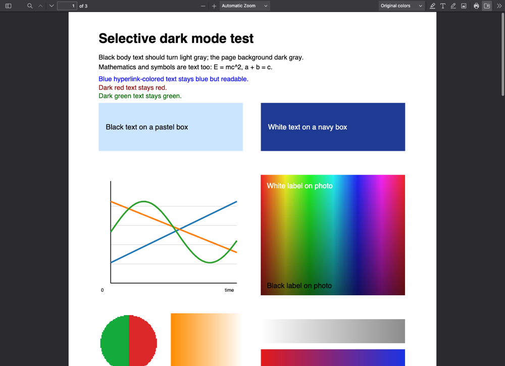
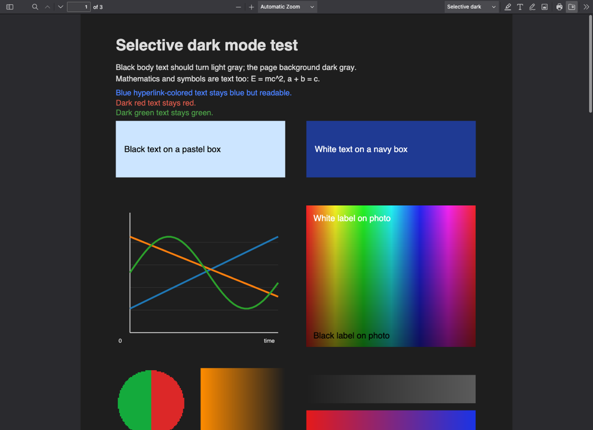
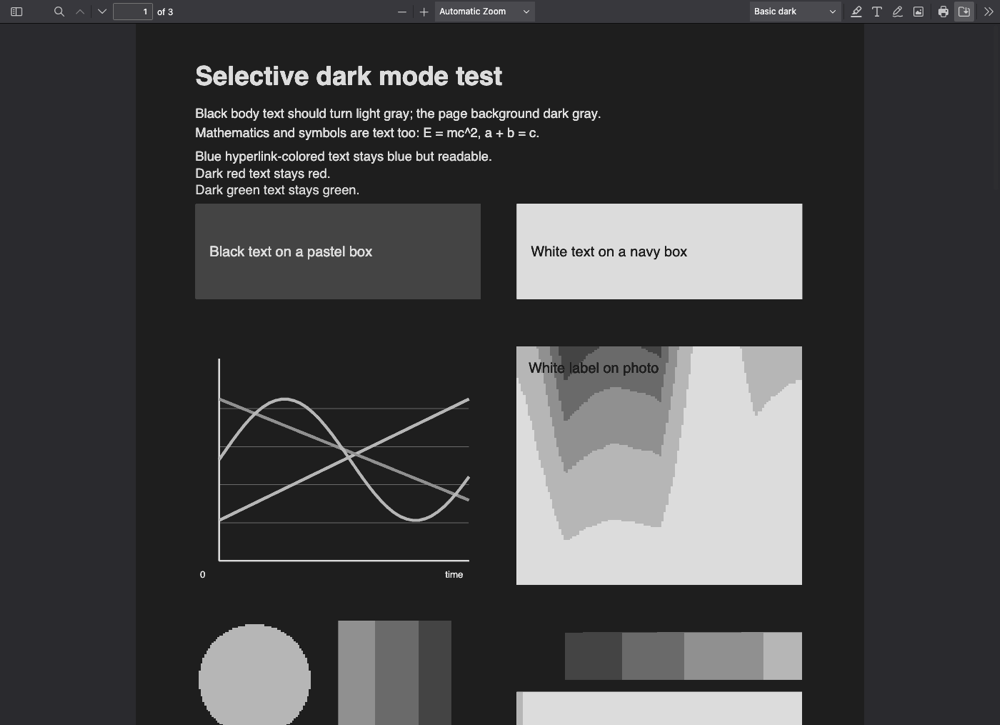

# Dark PDF Viewer for Firefox

A Firefox extension that opens PDFs in a bundled [PDF.js](https://github.com/mozilla/pdf.js) viewer instead of Firefox's built-in one, and adds a **selective dark mode**: page backgrounds, text and black-and-white line art are recolored, while photos, figures and other images keep their original colors.

| Original | Selective dark | Basic dark (PDF.js `pageColors`) |
| --- | --- | --- |
|  |  |  |

Everything runs locally. The PDF file itself is never modified: download and print give you the original.

## Features

- **Automatic interception.** Top-level PDF navigations open in the extension's viewer. Detection uses the `Content-Type` header, so URLs without a `.pdf` suffix work too (for example `https://arxiv.org/pdf/1804.03252`). Firefox's own viewer never flashes up first.
- **Your page stays put.** By default, a PDF opened from a page appears in a new tab next to it. The original tab keeps that page exactly as it was (scroll position, form input, Back history). A PDF that would load into an empty tab (new-tab page, or a link that already opened a new tab) loads right there. Same-tab opening is an option.
- **The full PDF.js viewer:** search, text selection, outline and thumbnails, zoom, rotation, presentation mode, annotations and forms, download, print.
- **Three color modes,** switchable from the viewer toolbar or the extension's toolbar button:
  - **Original colors.** Pages as authored.
  - **Basic dark.** PDF.js's built-in `pageColors` replacement. Fast, but images turn into posterized gray tones.
  - **Selective dark** (default). Recolors per drawing operation: text and gray line art are remapped and page backgrounds darkened, while raster images are drawn untouched. Colored vector art can keep its colors (default) or have its lightness reversed with the hue kept ("adapt").
- **Configurable** background and text colors, plus options for colored vector graphics, text drawn over images, and blend modes.
- **Per-site bypass** and a global on/off switch. **"Open in Firefox's PDF viewer"** in the viewer's Tools menu hands one PDF back to Firefox.
- PDFs served as downloads (`Content-Disposition: attachment`) are left alone unless you opt in.

## Install

### From the release (Firefox Developer Edition, Nightly, ESR, Zen and other forks)

The release `.xpi` is not signed by Mozilla, so the browser must allow unsigned add-ons:

1. Open `about:config` and set `xpinstall.signatures.required` to `false`. Regular Firefox release builds ignore this setting; see the next section for those.
2. Download `dark-pdf-viewer-<version>.xpi` from [Releases](../../releases), drag it into a browser window, and confirm.

### Temporary loading (any Firefox, including release)

1. Build the extension (below), or unzip the release `.xpi` into a folder.
2. Open `about:debugging#/runtime/this-firefox` and click **Load Temporary Add-on…**.
3. Choose `extension/manifest.json`.

Temporary add-ons are removed when the browser quits. For a permanent install on regular Firefox, sign the package through addons.mozilla.org (`web-ext sign`).

## Building from source

Requires Node.js 18+ and `unzip`.

```sh
npm install          # web-ext and selenium-webdriver (dev tools only)
npm run setup        # downloads PDF.js 6.4.299 into extension/pdfjs (checksum-verified)
npm test             # unit tests for detection and color mapping
npm run build        # packages dist/dark_pdf_viewer-<version>.zip (rename to .xpi)
npm start            # launches a throwaway Firefox profile with the extension loaded
```

`extension/pdfjs/` is generated and not committed. `npm run setup -- --zip <file>` installs from a local copy of the release zip.

### End-to-end tests

`test/e2e/run.mjs` drives a real Firefox through geckodriver. It serves generated test PDFs (`npm run fixtures`) from a local server, then checks interception, viewer features and the pixels each color mode produces: photo pixels identical, soft masks not inverted, and so on. Geckodriver 0.36 or newer is needed, because the harness uses `--allow-system-access`, without which WebDriver can't script `moz-extension://` pages.

```sh
FIREFOX_BINARY=/path/to/firefox GECKODRIVER=/path/to/geckodriver npm run e2e -- [--online] [--headed]
```

`--online` also loads the arXiv paper above. Screenshots land in `test/e2e/output/`.

## How it works

```
extension/
  background/   interception (webRequest) — detect.js is pure and unit-tested
  viewer/       boot.js, dark-render.js (rendering hooks), viewer-ui.js
  shared/       color.js (OKLab color mapping), settings.js
  popup/  options/  icons/
  pdfjs/        PDF.js release, generated by `npm run setup`
```

**Interception.** A blocking `webRequest.onHeadersReceived` listener (Manifest V2, persistent background page) looks at the headers of each top-level response. If it's a PDF, the listener sends it to `pdfjs/web/viewer.html?file=<url>`, before Firefox's viewer sees the body. In new-tab mode (the default), if the tab is showing a page worth keeping, the listener opens the viewer in a new tab beside it, in the same container, and cancels the original navigation. The cancelled load never commits, so the original page is left exactly as it was. Otherwise, or with new-tab mode off, it redirects the navigation in place. It skips downloads, non-GET requests, error statuses, bypassed sites, and the next PDF in a tab where you chose "Open in Firefox's PDF viewer", which prevents redirect loops. The viewer then fetches the PDF itself, with cookies, using range requests where the server supports them. That means one aborted request per intercepted PDF (headers only) plus the viewer's own fetch.

**Viewer.** `viewer.html` is the stock PDF.js generic viewer with two added tags: our stylesheet, and `viewer/boot.js`, loaded between `pdf.mjs` and `viewer.mjs`. The generic viewer rejects cross-origin `?file=` URLs. Instead of patching that check, `boot.js` hides the parameter from it (it comes off the address before the viewer starts and goes back afterwards), then opens the PDF itself with the options it needs.

**Rendering.** Selective mode patches PDF.js at runtime rather than forking it. It wraps `PDFPageProxy.prototype.render`, then reaches the private `InternalRenderTask` and `CanvasGraphics` classes through the render task, and wraps the paint operators (`showText`, `fill`, `stroke`, the image-mask operators, `beginGroup`/`endGroup`, `setGState`, shading lookups). Each wrapper swaps the canvas fill/stroke style for the duration of one operator and then restores it. Image operators are never recolored. They only record where they landed, so text drawn on top of a photo keeps its colors. Details, color math and limitations: [docs/RENDERING.md](docs/RENDERING.md).

### Changes to PDF.js

- No PDF.js file is modified except `web/viewer.html`, which gains the two tags above (applied by `scripts/fetch-pdfjs.mjs`, which fails loudly if the anchors move). The sample PDF and source maps are dropped from the bundle.
- Selective mode depends on private PDF.js internals: method names on `CanvasGraphics`, `renderTask._internalRenderTask`, `initializeGraphics`, `current.getClippedPathBoundingBox()`, and the `_colorStops` field on axial/radial shading patterns. The PDF.js version is pinned (with a checksum) for that reason. Missing hooks are logged and selective mode degrades gracefully. After upgrading PDF.js, run the end-to-end suite.

## Credits

- [PDF.js](https://github.com/mozilla/pdf.js) by Mozilla (Apache-2.0), bundled unmodified apart from `viewer.html`.
- [Veil](https://github.com/simoneamico-ux-dev/veil) was studied before writing the renderer. It inverts the whole page with a CSS filter, then paints image rectangles back from an un-inverted render. That is the approach this project avoids, but its handling of already-dark pages informed the "leave page-sized dark fills alone" rule.
- [doq](https://github.com/shivaprsd/doq) and Zotero's PDF reader take a similar paint-time approach using CIELAB. Here the mapping is OKLab-based and the hooks sit at the operator level instead of the canvas-context level.
