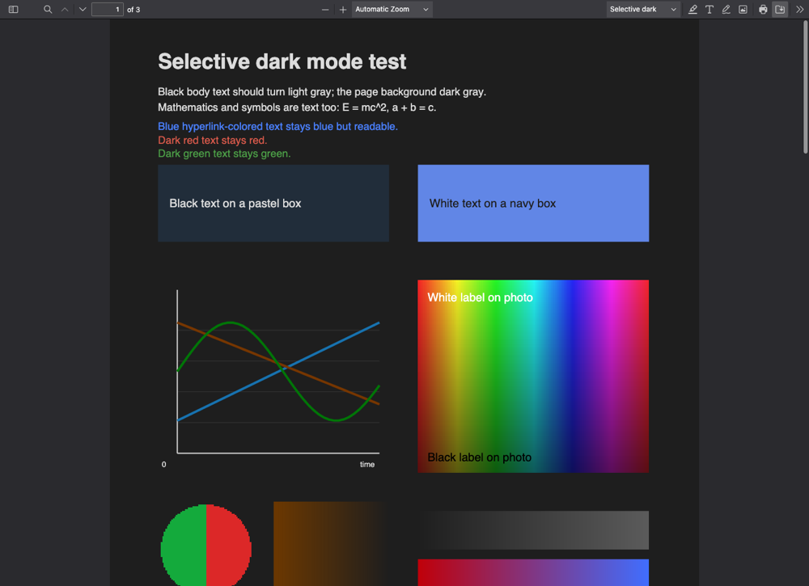

# Rendering notes

How the two dark modes work, what each one preserves, and where they fall short.

## Mode A: basic dark (PDF.js `pageColors`)

PDF.js's `pageColors` option exists for Windows high-contrast mode. In PDF.js 6.x it is applied *after* the page is drawn: `CanvasGraphics.endDrawing()` re-draws the whole canvas through an SVG filter (`DOMFilterFactory.addHCMFilter`). The filter:

1. converts every pixel to luminance (grayscale),
2. maps luminance onto a 6-step ramp from the foreground to the background color.

**Evaluation:** text and backgrounds come out right, and it is the fastest mode. But every image becomes a posterized gray duotone, and colored text and plots lose their colors. On the test fixture, photo pixels had a maximum channel spread of **0** (pure gray), compared with **165** originally. So `pageColors` cannot preserve images, and that is why selective mode exists.

## Mode B: selective dark

### Where the hooks go

PDF.js draws a page by replaying the page's operator list through the private `CanvasGraphics` class, one method per PDF operator. We wrap a subset of those methods at runtime (see `extension/viewer/dark-render.js`):

- `PDFPageProxy.prototype.render` decides the mode for each render. Only `intent: "display"` renders are recolored, so printing always uses the original colors. In selective mode it passes `background: <dark color>` (PDF.js paints that before any operator runs) and creates per-render state.
- `InternalRenderTask.prototype.initializeGraphics`, reached through `renderTask._internalRenderTask`, attaches that state to the task's `CanvasGraphics` instance and patches the `CanvasGraphics` prototype once.
- `CanvasGraphics` operators are dispatched by number (`this[OPS.fill](…)`) but call each other by name, so each wrapper is installed under both keys.

Colors are swapped on the canvas context only for the duration of a single paint operator, then restored. PDF.js's own graphics state (`this.current.fillColor`, save/restore stacks, transparency group copies) never holds a mapped color, so nested and composited content behaves as PDF.js expects.

### What happens to each kind of content

| Content | PDF.js operator(s) | Treatment |
| --- | --- | --- |
| Page background | `beginDrawing` | Filled with the configured background color. |
| Text | `showText` (also Type3 glyph procedures run inside it) | Gray/black text is remapped onto the fg↔bg ramp. Colored text keeps its hue and gets enough lightness to be readable. |
| Filled shapes | `fill` (`eoFill`, `fillStroke`, … all route through it) | Gray fills are remapped (white boxes become dark). Colored fills are **kept** (default) or lightness-reversed ("adapt"). Fills covering ≥ 50% of the page are treated as page backgrounds and always remapped, unless they are already dark (slides with black backgrounds stay as they are). |
| Strokes / lines | `stroke` | Gray/black lines are remapped. Colored lines follow the vector policy. Very dark colored lines get a small lightness lift so they don't vanish into the background. |
| Raster images, photos, scans | `paintInlineImageXObject(Group)` (`paintImageXObject*` delegate here) | **Never recolored.** Their device-space rectangle is recorded. |
| Stencil masks | `paintImageMaskXObject*`, `paintSolidColorImageMask`, `rawFillPath` | Recolored like text. These paint the current color through a 1-bit mask: bitmap fonts, Type3 glyphs, some icons and B/W scans. |
| Axial / radial gradients | `_getPattern` (used by `sh` and shading patterns) | All-gray gradients are remapped. Colored ones follow the vector policy, and page-sized ones are always remapped. |
| Mesh shadings, tiling patterns | — | Kept as artwork. |
| Soft-mask definitions | `beginGroup` with `group.smask` … `endGroup` | **Never recolored.** Their luminance becomes alpha, so recoloring would invert the transparency. Content drawn *through* a soft mask is recolored normally. |
| Transparency groups | `beginGroup`/`endGroup` | Recolored inside. The offset of the group's scratch canvas is tracked so recorded regions stay in page coordinates. |
| Blend modes | `setGState` (`BM`) | On a dark theme, `multiply`↔`screen`, `darken`↔`lighten` and `color-burn`↔`color-dodge` are swapped. For example, a multiply highlight becomes a screen highlight, so it still tints the page instead of turning it black. |

#### Keeping colors over images

Each image's rectangle, and each fill whose color was kept, is recorded in paint order. When text, a fill, a stroke or a stencil is about to be painted, the topmost recorded region under its anchor point decides what happens. If that region kept its colors, so does the new content. This keeps a black label on a photo black, and white text on a navy box white (when colored boxes are kept). A later dark-mapped fill drawn over an image correctly takes precedence. Regions smaller than 0.04% of the page are not tracked.

### Color math (`extension/shared/color.js`)

All mapping is in OKLab.

- **Gray ramp.** A color with lightness `L` maps to `mix(fg, bg, L)`: black lands exactly on the foreground color, white exactly on the background, grays in between, carrying the theme's tints.
- **Chroma weight.** Chroma `C = √(a² + b²)` is smooth-stepped between 0.02 and 0.06. Below that, colors are treated as gray. Above it, they are colored. In between, the two treatments are blended, so near-gray colors don't jump.
- **Reversing lightness ("adapt").** `L' = L_fg + (L_bg − L_fg)·L`, keeping `a` and `b`, so hue and chroma are kept. Mid-tones near `L ≈ 0.53` barely change. Out-of-gamut results lose chroma, never lightness or hue.
- **Readable text.** Colored text uses whichever of the original or reversed lightness stands further from the background, and never less than 60% of the fg/bg lightness gap.
- **Preserving colored vector art** (default). Kept exactly, unless the color sits within 0.12 lightness of the background, in which case it is lifted just enough to stay visible.

Because the lightness mapping is monotonic, the contrast between any two remapped colors is preserved (with its polarity reversed). That is why "adapt" keeps pastel boxes with black text readable: the box goes dark and the text goes light.

## Limitations

**Content-related**

- **Scanned PDFs** are raster images, so the page stays light. This is deliberate: there is no destructive inversion of the scan. Exception: scans stored as 1-bit stencil masks are recolored like text, which gives a true dark page.
- **Text converted to vector paths** (outlined fonts, some design tools and plotting libraries) is indistinguishable from line art. Black outlined text is still remapped. Colored outlined text follows the vector policy rather than the readable-text rule.
- **Text baked into images** (screenshots, raster figures) keeps its original colors, by design.
- **Vector heatmaps / colormaps** are kept under the default policy. Under "adapt" their lightness is reversed, so colormaps no longer match their published meaning, although colorbars change consistently with them.
- **Colored boxes containing gray line art.** Under the default policy the box keeps its color, and so do lines whose anchor falls inside it. Lines that merely cross the box are remapped and may lose contrast against it.
- **Region tests use bounding boxes.** Rotated, clipped or non-rectangular images and fills are approximated by their axis-aligned box. Text uses one anchor point per run.
- **Full-page background images** (rare) keep the whole page light, and the text on them keeps its original colors.
- PDF transfer functions (`TR`) are applied to the original color, not the mapped one. Form fields that PDF.js renders on separate canvases are recolored, but without region tracking.

**Interception-related**

- Only top-level navigations are intercepted. PDFs embedded in `<iframe>`/`<embed>` and `file://` PDFs stay with Firefox: extensions can't read `file://` URLs, so open local files via the viewer's Open button. POST responses are also left alone, since the viewer would have to re-request them with GET.
- PDFs served as `attachment` download normally unless the option is enabled.
- Each intercepted PDF costs one extra, aborted request (headers only) before the viewer fetches it.

**Technical**

- Selective mode depends on private PDF.js internals (listed in the README), so the bundled PDF.js version is pinned.
- Firefox only. Uses Manifest V2 with a persistent background page, for reliable blocking `webRequest`.
- **Open issue:** in WebDriver screenshots at 1× device pixel ratio, text in some PDFs with embedded fonts (arXiv 1804.03252) appears dark on the dark page. The canvas pixel data is correct (light text, verified with `getImageData`), and the same page displays correctly at 2×. Disabling accelerated or remote canvas, or not restoring the fill style after each operator, did not change the screenshot. It has not been confirmed on a physical 1× display.

## Performance

Measured in the end-to-end run (headless Firefox 158, 20 pages of `large.pdf` at 2× scale, mean per page): original 8.6 ms, basic 13.3 ms (one extra full-canvas filter pass), selective 8.1 ms. The per-operator overhead is a memoized color lookup and occasional bounding-box bookkeeping. PDF.js still renders lazily and caps canvas size (`maxCanvasPixels`, detail canvases for high zoom), so large documents and high-DPI screens behave as in stock PDF.js.
